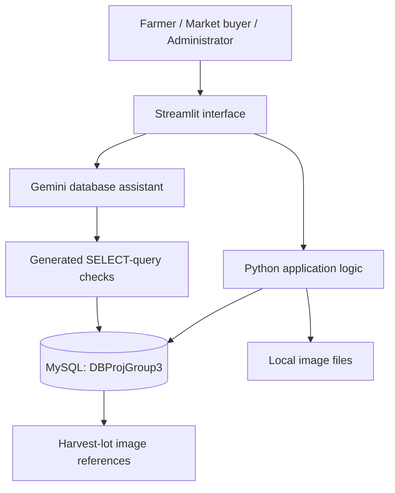

<div align="center">

# 🌱 HarvestLink

### Connecting Local Farms to Local Markets

**A Farm-to-Market Food Availability & Inventory Management System**


*From local farms to local markets.*

</div>

## Overview

HarvestLink is a Python application built with Streamlit and MySQL for managing local agricultural supply, harvested inventory, market requests, and deliveries. It includes separate farmer, market buyer, and administrator workflows, harvest-lot images, and a Gemini-powered database assistant.

> [!NOTE]
> This is an educational prototype for COSC444 at Khalifa University. Use fictional demonstration data. It does not connect to government systems or represent official UAE food inventories.

> [!IMPORTANT]
> The current assistant uses the Google Gen AI SDK directly. **LangChain integration is still pending**, although it is required by the project proposal. Features listed below describe implementation, not a completed end-to-end test certification.

## Implemented Features

| Area | Current functionality |
|:---|:---|
| Farm management | Register and edit farms; associate farmers through `OwnedBy`; create and update crop cycles with expected quantities and harvest dates |
| Harvests and inventory | Record harvest lots; calculate stock on hand, reserved stock, and available stock from movements; record losses and corrections |
| Market operations | Search produce; create and update requests; reserve produce through farmer allocations; cancel reservations; confirm deliveries and discrepancies |
| History | Completed crop-cycle history, inactive harvest-lot history, and past allocations |
| Images | JPG/PNG upload controls; images linked to lots; persistent local files; duplicate pixel detection within a lot; safe image display |
| Accounts and audit | Registration, hashed-password login, explicit logout, session state, ownership checks, sensitive-operation logging, and administrator activity views |
| Administration | Manage users and roles; add crops and markets; inspect operational records and responsible users |
| Assistant | Natural-language questions through Gemini, generated SELECT-query checks, supporting SQL/results, and answer summaries |
| Error handling | Friendly database messages, form validation, rollback, and transaction locking in key inventory operations |

### User Roles

| Database role | Application user | Main actions |
|:---|:---|:---|
| `farmer` | Farmer | Manage assigned farms, crop cycles, lots, images, stock movements, and allocations |
| `user` | Market buyer | Search produce, manage personal requests, and confirm received deliveries |
| `admin` | Administrator | Manage reference data and user roles; review operational records and security activity |

### Inventory and History

- Expected harvests are forecasts and remain separate from harvested inventory.
- Available quantity is stock on hand minus reserved quantity.
- Quantities carry explicit units: `g`, `kg`, `ton`, `box`, or `piece`. Units are currently configured in Python; automatic conversions are not implemented.
- Reservations, releases, deliveries, losses, and corrections are recorded as dated stock movements.
- Key allocation, cancellation, delivery, and adjustment operations use transactions and row locks to coordinate stock changes.
- Harvest-lot activation is managed explicitly. Zero availability does not automatically change the stored active/inactive status.
- Request-status history and stock movements retain the responsible user and relevant details.

## Architecture



The current interface, database helpers, business logic, and assistant are in `code/applicationn1.py`. A future refactor can separate these modules without changing the application framework.

## Technology Stack

| Component | Technology |
|:---|:---|
| Application / GUI | Python and Streamlit |
| Database | MySQL |
| Database access | SQLAlchemy and PyMySQL; parameterized queries for application operations |
| Data tables | pandas |
| Image processing | Pillow |
| Configuration | python-dotenv |
| Current AI integration | Google Gen AI SDK (`google-genai`) |
| Required future integration | LangChain |

## Project Structure

```text
HarvestLink/
|-- code/
|   |-- applicationn1.py
|   |-- requirements.txt
|   |-- images/
|   `-- .env                       # Local configuration; ignored by Git
|-- database design/
|   |-- projectERDiagram.jpg
|   `-- projectSchema.png
|-- sql/
|   |-- DBProjGroup3.sql            # Schema
|   `-- populateDB.sql              # Sample records
|-- Local_Farm_Market_Food_Availability_Project_Proposal.pdf
|-- .gitignore
`-- README.md
```

### Database Tables and Sample Data

The schema includes `Users`, `Farms`, `OwnedBy`, `Crops`, `CropCycle`, `HarvestLots`, `HarvestLotImages`, `StockMovements`, `Markets`, `MarketRequests`, `RequestStatusHistory`, `Allocations`, `DeliveryReceipts`, and `UserActivityLog`.

The population script supplies 4 farms, 4 markets, 5 crops, 16 crop cycles, 12 harvest lots, 35 stock movements, 9 market requests, and 6 delivery receipts. It includes reservations, losses, delivery discrepancies, and image references. These counts meet the proposal's minimum population requirements; records added while using the app will increase live database counts.

## Getting Started

### Prerequisites

- Python 3.11 or newer recommended.
- A running MySQL server with a database account permitted to create the initial schema and tables.
- MySQL Workbench or the MySQL command-line client for importing SQL.
- A Gemini API key and an available model name if using the assistant. Core application pages do not require an API key.

### 1. Create the Database

From the repository root, open MySQL Workbench and execute these scripts **in order**:

1. `sql/DBProjGroup3.sql`
2. `sql/populateDB.sql`

Alternatively, start the MySQL client from the repository root:

```powershell
mysql -u YOUR_MYSQL_USER -p
```

Then run these commands inside the MySQL client:

```sql
SOURCE sql/DBProjGroup3.sql;
SOURCE sql/populateDB.sql;
```

Both scripts select the database `DBProjGroup3`. Import them into a fresh project database: table creation and seed inserts are not designed for repeated execution against an already populated database.

### 2. Install Python Dependencies

Open PowerShell in the repository root:

```powershell
cd code
python -m venv .venv
.\.venv\Scripts\python.exe -m pip install -r requirements.txt
```

These commands use the environment's Python directly, so PowerShell activation is unnecessary. Create the environment on your own computer rather than copying another developer's `.venv`.

On macOS/Linux, from the repository root:

```bash
cd code
python3 -m venv .venv
.venv/bin/python -m pip install -r requirements.txt
```

### 3. Configure Local Settings

Create `code/.env` with your own local values:

```dotenv
DB_HOST=localhost
DB_PORT=3306
DB_USER=YOUR_MYSQL_USER
DB_PASSWORD=YOUR_MYSQL_PASSWORD
DB_NAME=DBProjGroup3

# Optional: needed only for the database assistant.
GEMINI_API_KEY=YOUR_GEMINI_API_KEY
GEMINI_MODEL=YOUR_AVAILABLE_GEMINI_MODEL
```

Replace placeholders before running. The model name must be available to your API account. Keep `.env` local; it is ignored by Git. Database connection settings are cached, so restart Streamlit after changing them.

### 4. Start Streamlit

From the `code` directory on Windows:

```powershell
.\.venv\Scripts\python.exe -m streamlit run applicationn1.py
```

On macOS/Linux:

```bash
.venv/bin/python -m streamlit run applicationn1.py
```

Open the URL printed in the terminal, normally **http://localhost:8501**. Keep MySQL and the terminal running. Press **Ctrl+C** in the terminal to stop Streamlit.

### 5. Sign In or Create a Demonstration Account

Use the Sign up tab to create a fictional farmer or market buyer account. Administrator creation is not available through public sign-up; use the seeded administrator account with the team's demonstration credentials. The seed script stores password hashes rather than plaintext passwords.

After signing in, the sidebar shows the pages for the account's role. The database connection test is also available in the sidebar.

## Image Storage

Uploads are saved as PNG files in `code/images/`, with filenames recorded in `HarvestLotImages`. The image resolver also supports a repository-level `images/` folder and case-insensitive filename matching.

- Keep image files alongside the SQL records when sharing or submitting the project; the database does not contain the image binaries.
- Uploads have a 5 MB input limit and a 20-megapixel dimension check.
- Duplicate detection compares normalized pixel fingerprints within the same harvest lot. Resized or recompressed versions may have different fingerprints.
- Missing or corrupt images display friendly messages; diagnostic details remain in the terminal.
- Successful upload messages survive Streamlit reruns.
- Restart persistence depends on retaining the local image directory. Demonstrate upload, restart, and retrieval before submission.

## Assistant and Security Status

The assistant reads database structure, asks Gemini to generate SQL, checks the query, executes it, and displays a summary with supporting records. Try questions using seeded crops, such as "Which farms have carrots available?" or "Show partially fulfilled market requests."

The current query validator checks for SELECT statements, multiple statements, and blocked keywords. Role restrictions are also described in the model prompt. Database-enforced read-only access and execution-time ownership restrictions still need to be completed and tested; prompts alone are not an authorization boundary.

The selected advanced-feature implementation is **secure login and activity audit**. Administrators can inspect login/logout timestamps, sensitive actions, responsible users, affected-record details, and denied-access demonstrations. Explicit logout records session duration. Automatic session expiry and browser-close logout auditing are not implemented. Passwords currently use SHA-256; a salted password-hashing method remains an improvement.

## Remaining Work

- Integrate LangChain into the GUI assistant and enforce read-only, role-scoped execution.
- Add a selectable availability-date filter to buyer produce search.
- Add database-backed administrator management of units.
- Validate decoded image formats as JPEG/PNG, and show individual reasons for failed multi-image uploads.
- Complete end-to-end, boundary, repeated-request, rollback, and concurrency tests.
- Verify the earlier buyer request issue through a live harvest-to-request-to-allocation workflow.
- Document test cases with expected and actual results, including at least 10 assistant questions with ambiguous and unanswerable examples.
- Verify diagrams against the latest schema and retain the Draw.io ER source.
- Document individual team responsibilities.
- Produce the technical PDF and poster PDF, rehearse the 15-minute presentation, and assemble the final ZIP.

Only one advanced feature is required by the proposal. Analytics, smart demand matching, forecasting, and loss/surplus management are optional alternatives to the implemented login/audit feature.

## Verification Checklist

Record actual results rather than treating this checklist as completed test evidence.

- [ ] Create a harvest and verify available, reserved, and on-hand quantities.
- [ ] Create a buyer request, allocate stock, cancel a reservation, and verify request/status history.
- [ ] Confirm a partial delivery and verify stock changes and discrepancy records.
- [ ] Reject excess allocations, invalid dates/units, duplicate records, and unauthorized actions.
- [ ] Test simultaneous allocations and repeated delivery confirmations.
- [ ] Upload JPG/PNG images, reject duplicates/invalid files, and retrieve images after restarting.
- [ ] Confirm friendly handling of missing/corrupt images and database failures.
- [ ] Check admin audit entries for login, logout, sensitive actions, and denied access.
- [ ] Test at least 10 assistant questions against SQL results.

## Troubleshooting

| Symptom | Check |
|:---|:---|
| Cannot connect to the database | Start MySQL, verify `.env`, confirm `DBProjGroup3` exists, and restart Streamlit after configuration changes |
| Missing tables or no sample records | Import the schema first, then the population script |
| Image unavailable | Check that the exact filename referenced by `HarvestLotImages.imageName` exists in a supported image folder |
| No produce in search | Check filters, lot activation, remaining unreserved quantity, harvest date, and sell-by date; seeded dates are fixed |
| Assistant not configured or unavailable | Set an API key and an account-supported model name in `.env`; check the terminal for diagnostic details |
| Python environment points to another computer | Recreate `.venv` locally and reinstall requirements |

## Academic Information and Team

**Khalifa University of Science and Technology** | Computer Science | **COSC444 - Database Systems** | Fall 2026-2027

| Team member | Responsibility |
|:---|:---|
| Tehsin Shaik | To be documented |
| Raghad Elajab | To be documented |
| Ayesha Almheiri | To be documented |

All team members must contribute to database design and implementation.

## License

Developed for educational purposes. A license has not yet been selected.
