<div align="center">

# 🌱 HarvestLink

### Connecting Local Farms to Local Markets

**A Farm-to-Market Food Availability & Inventory Management System**

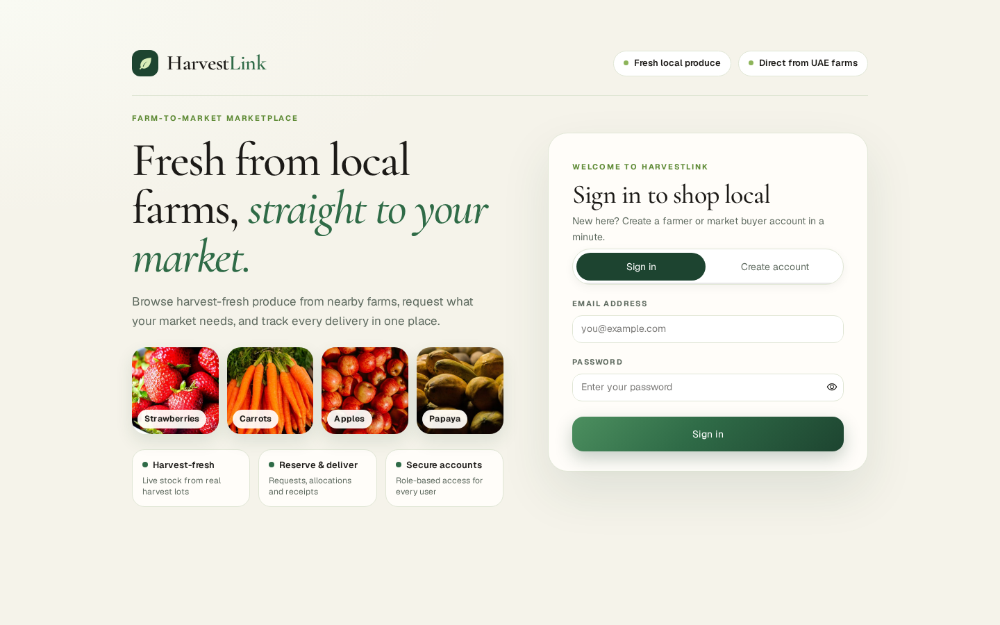


*From local farms to local markets.*

</div>

---

## Overview

HarvestLink is a Python application built with Streamlit and MySQL for managing local agricultural supply, harvested inventory, market requests, and deliveries. Farmers record what they grow and harvest, market buyers shop for available produce and request it, and farmers reserve stock against those requests until the buyer confirms delivery. Administrators manage accounts, reference data, and the audit trail.

The interface is styled as a green farm marketplace, and **FittonAI**, a LangChain and Gemini assistant, answers plain-English questions about the records each account is allowed to see.

> [!NOTE]
> This is an educational prototype for COSC444 at Khalifa University. Use fictional demonstration data. It does not connect to government systems or represent official UAE food inventories.

---

## Screenshots

### Farmers

<table>
<tr><td width="50%" valign="top">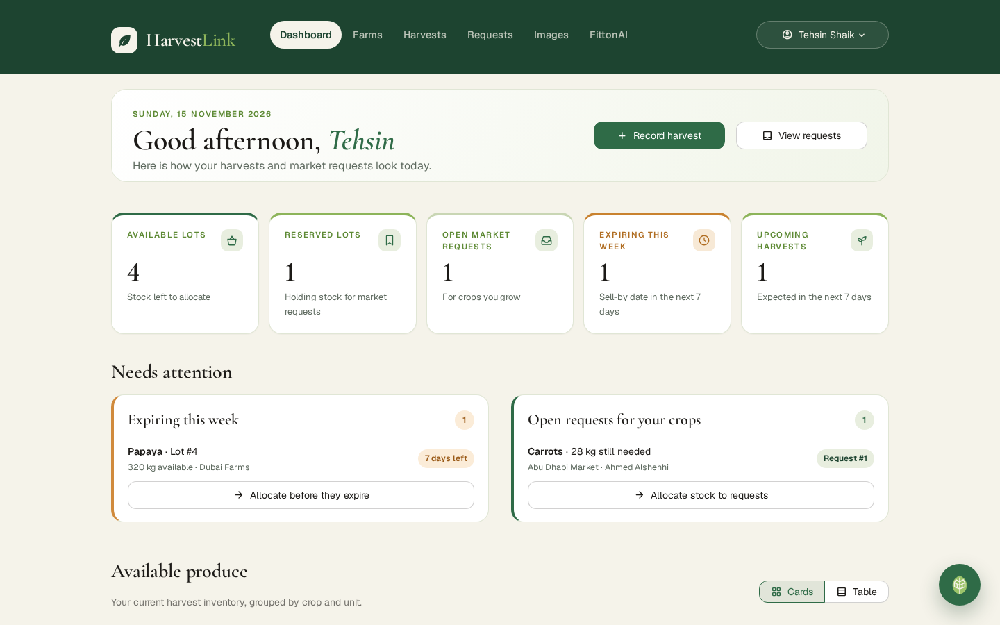<br><sub><b>Dashboard</b> · greeting, stock summary, items needing attention and produce cards</sub></td><td width="50%" valign="top">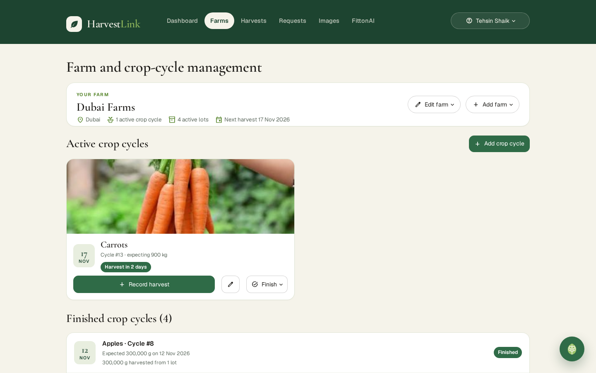<br><sub><b>Farms</b> · farm details, active crop cycles and finished cycles</sub></td></tr>
<tr><td width="50%" valign="top">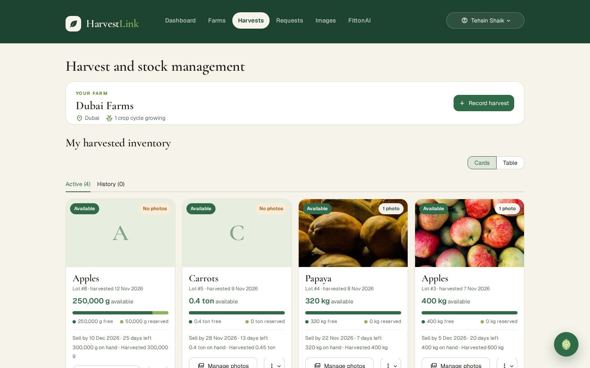<br><sub><b>Harvests</b> · harvested lots as cards with stock, photos and lot actions</sub></td><td width="50%" valign="top">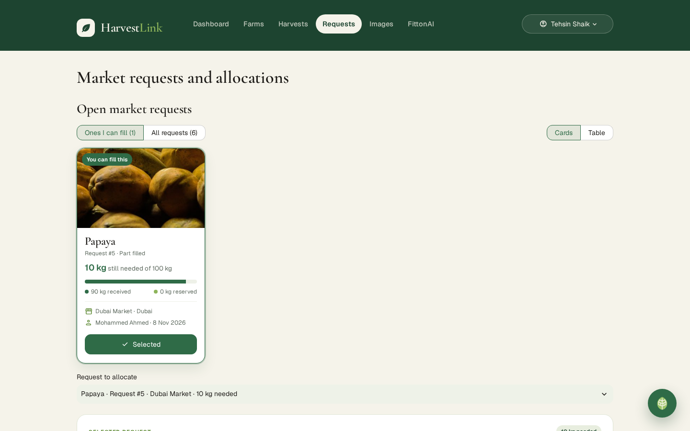<br><sub><b>Requests</b> · open buyer requests and stock allocation</sub></td></tr>
</table>

<table>
<tr><td width="50%" valign="top">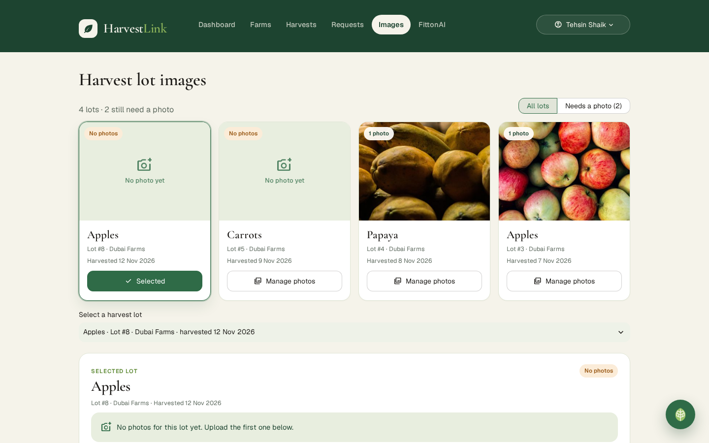<br><sub><b>Images</b> · photos for each harvest lot</sub></td><td width="50%" valign="top">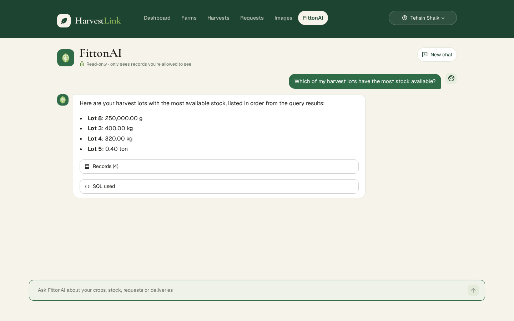<br><sub><b>FittonAI</b> · answers with the supporting records and SQL</sub></td></tr>
</table>

### Market buyers

<table>
<tr><td width="50%" valign="top">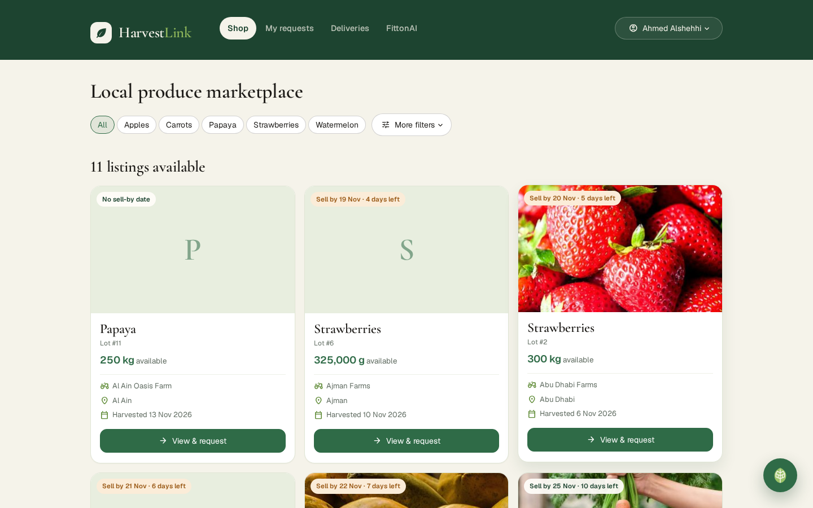<br><sub><b>Shop</b> · produce cards with crop chips and filters</sub></td><td width="50%" valign="top">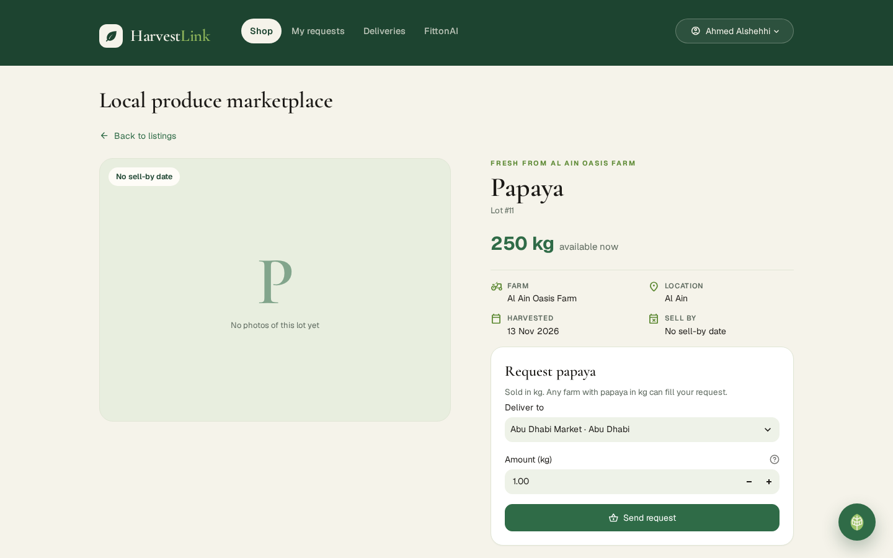<br><sub><b>Listing</b> · lot details and the request panel</sub></td></tr>
<tr><td width="50%" valign="top">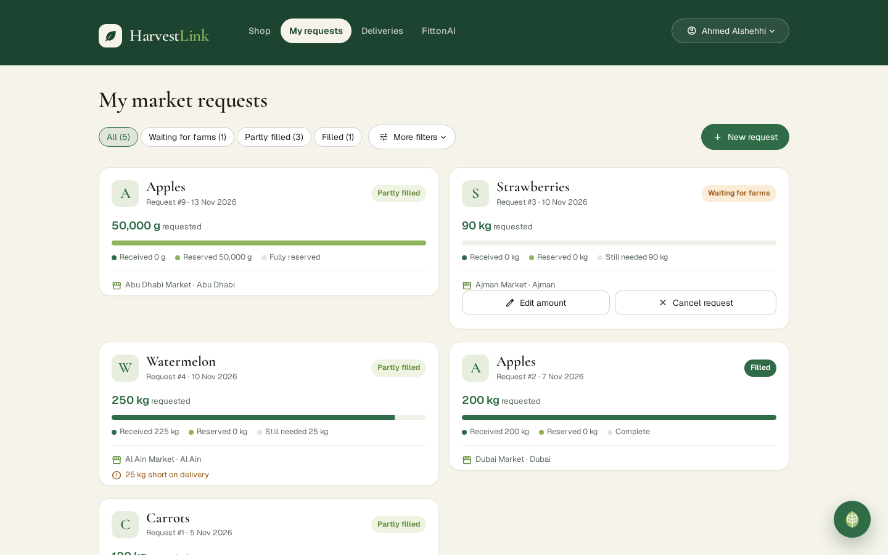<br><sub><b>My requests</b> · status chips, progress and edit or cancel pop-ups</sub></td><td width="50%" valign="top">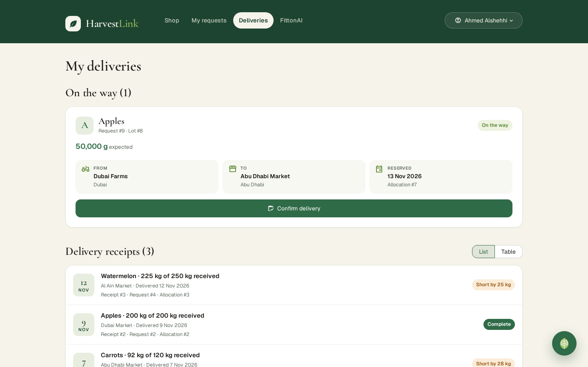<br><sub><b>Deliveries</b> · incoming deliveries and receipts</sub></td></tr>
</table>

### Administrators

<table>
<tr><td width="50%" valign="top">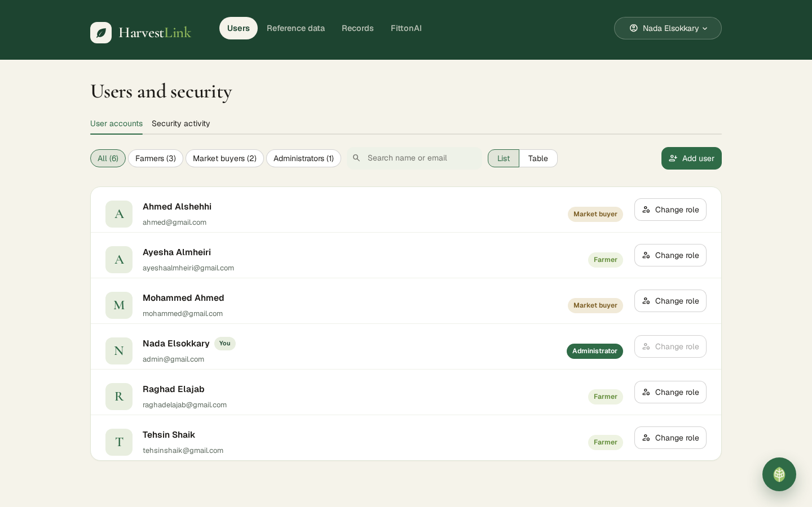<br><sub><b>Users and security</b> · accounts, roles and security activity</sub></td><td width="50%" valign="top">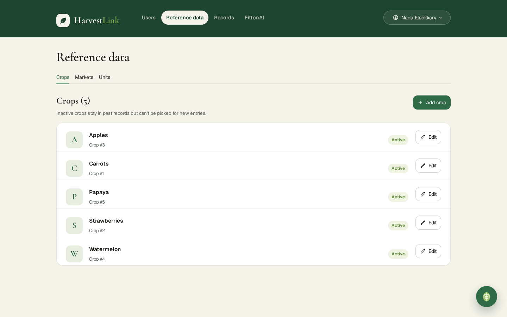<br><sub><b>Reference data</b> · crops, markets and units</sub></td></tr>
<tr><td colspan="2" valign="top">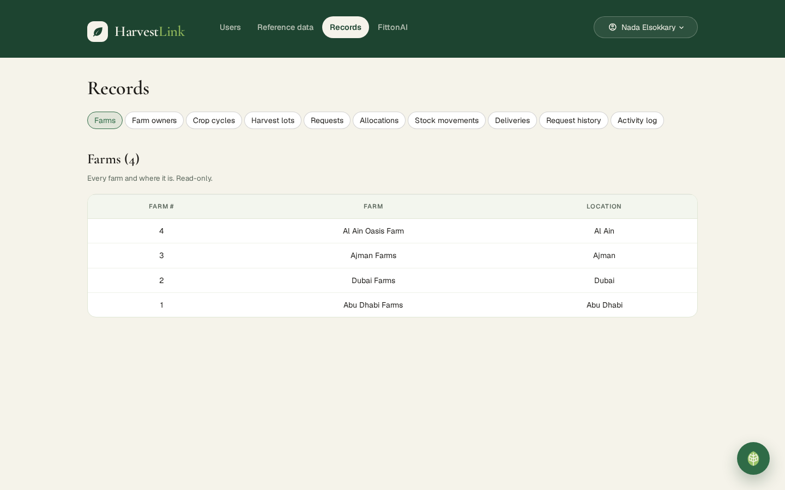<br><sub><b>Records</b> · read-only operational records with readable columns</sub></td></tr>
</table>

### On phones

Every page adapts to narrow screens: the navigation wraps, cards stack, and wide tables scroll sideways.

<p align="center">
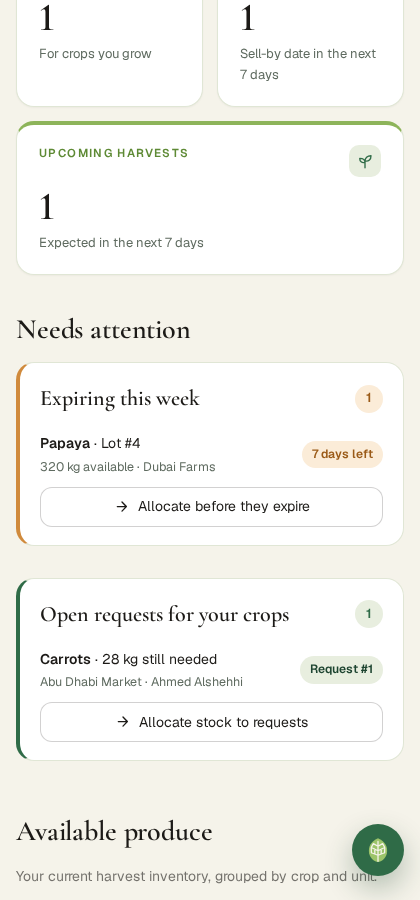
&nbsp;&nbsp;
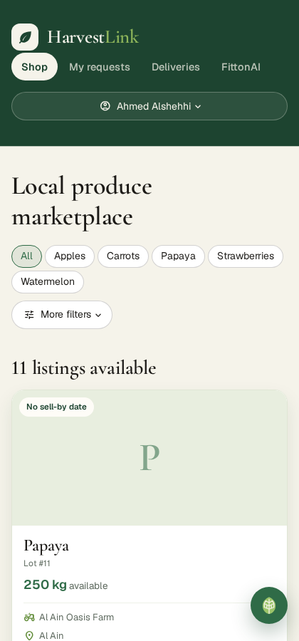
</p>

---

## Implemented Features

| Area | Current functionality |
|:---|:---|
| Farm management | Register and edit farms; associate farmers through `OwnedBy`; create and update crop cycles with expected quantities and harvest dates |
| Harvests and inventory | Record harvest lots; calculate stock on hand, reserved stock, and available stock from movements; record losses and corrections |
| Market operations | Shop produce by crop, farm, location, unit, available-on date, and minimum quantity; create, edit, and cancel requests; reserve produce through farmer allocations; release reservations; confirm deliveries and discrepancies |
| History | Completed crop-cycle history, inactive harvest-lot history, past allocations, and delivery receipts |
| Images | JPG/PNG upload controls; images linked to lots; persistent local files; duplicate pixel detection within a lot; safe image display |
| Accounts and audit | Registration, salted Argon2id password hashing, legacy-hash migration on login, explicit logout, session state, ownership checks, sensitive-operation logging, and an administrator activity timeline |
| Administration | Manage users and roles; add and edit crops and markets; add, deactivate, and reactivate units; inspect read-only operational records and responsible users |
| FittonAI | Natural-language questions through LangChain and Gemini, role-scoped read-only SQL, supporting records and SQL, and answer summaries |
| Interface | Green marketplace theme, top navigation, cards and lists with status pills, pop-up forms, List/Table switches, and phone layouts |
| Error handling | Friendly database messages, form validation, rollback, and transaction locking in key inventory operations |

### User Roles

| Database role | Application user | Pages |
|:---|:---|:---|
| `farmer` | Farmer | Dashboard, Farms, Harvests, Requests, Images, FittonAI |
| `user` | Market buyer | Shop, My requests, Deliveries, FittonAI |
| `admin` | Administrator | Users, Reference data, Records, FittonAI |

### Inventory and History

- Expected harvests are forecasts and remain separate from harvested inventory.
- Available quantity is stock on hand minus reserved quantity.
- Quantities carry explicit units. The `Units` table is seeded with `g`, `kg`, `ton`, `box`, and `piece`; administrators can add units and change their active status under **Reference data > Units**. Forms load active units from the database, and deactivation preserves historical records. Automatic conversions are not implemented.
- Reservations, releases, deliveries, losses, and corrections are recorded as dated stock movements.
- Key allocation, cancellation, delivery, and adjustment operations use transactions and row locks to coordinate stock changes.
- Harvest-lot activation is managed explicitly. Zero availability does not automatically change the stored active/inactive status.
- Request-status history and stock movements retain the responsible user and relevant details.

---

## Architecture

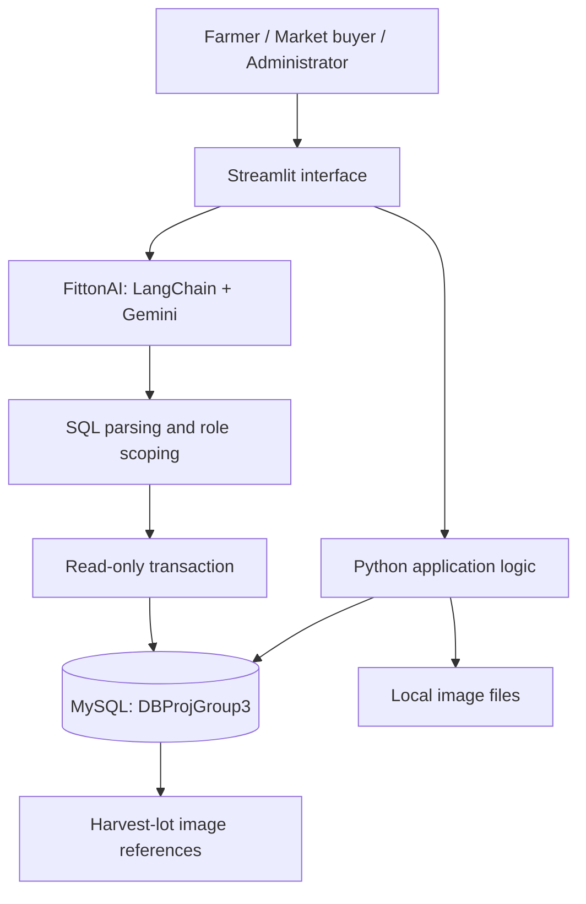

The current interface, database helpers, business logic, and FittonAI are in `code/application langchain edits.py`, styled by `code/style.css` and `code/.streamlit/config.toml`. `code/application.py` is the earlier version, before the LangChain integration and the interface redesign.

## Technology Stack

| Component | Technology |
|:---|:---|
| Application / GUI | Python and Streamlit, with a custom theme and stylesheet |
| Database | MySQL |
| Database access | SQLAlchemy and PyMySQL; parameterized queries for application operations |
| Data tables | pandas |
| Image processing | Pillow |
| Configuration | python-dotenv |
| Password hashing | Argon2id through `argon2-cffi` |
| AI integration | LangChain (`langchain`, `langchain-google-genai`) with Gemini |
| SQL checks | `sqlglot` |

## Project Structure

```text
HarvestLink/
|-- assets/
|   `-- screenshots/               # README screenshots
|-- code/
|   |-- application langchain edits.py   # Current application
|   |-- application.py             # Earlier version, kept for reference
|   |-- style.css                  # Interface styles
|   |-- .streamlit/
|   |   `-- config.toml            # Theme colours and fonts
|   |-- requirements.txt
|   |-- images/
|   `-- .env                       # Local configuration; ignored by Git
|-- database design/
|   |-- projectERDiagram.jpg
|   `-- projectSchema.png
|-- sql/
|   |-- DBProjGroup3.sql            # Schema
|   `-- populateDB.sql              # Sample records
|-- Local_Farm_Market_Food_Availability_Project_Proposal.pdf
|-- .gitignore
`-- README.md
```

### Database Tables and Sample Data

The schema includes `Units`, `Users`, `Farms`, `OwnedBy`, `Crops`, `CropCycle`, `HarvestLots`, `HarvestLotImages`, `StockMovements`, `Markets`, `MarketRequests`, `RequestStatusHistory`, `Allocations`, `DeliveryReceipts`, and `UserActivityLog`.

The population script supplies 4 farms, 4 markets, 5 crops, 16 crop cycles, 12 harvest lots, 35 stock movements, 9 market requests, and 6 delivery receipts. It includes reservations, losses, delivery discrepancies, and image references. These counts meet the proposal's minimum population requirements; records added while using the app will increase live database counts.

---

## Getting Started

### Prerequisites

- Python 3.11 or newer recommended.
- A running MySQL server with a database account permitted to create the initial schema and tables.
- MySQL Workbench or the MySQL command-line client for importing SQL.
- A Gemini API key and an available model name if using FittonAI. Core application pages do not require an API key.

### 1. Create the Database

Open the cloned or downloaded repository folder containing this README, `code/`, and `sql/`. Run repository-root commands from that folder.

From the repository root, open MySQL Workbench and execute these scripts **in order**:

1. `sql/DBProjGroup3.sql`
2. `sql/populateDB.sql`

Alternatively, start the MySQL client from the repository root:

```powershell
mysql -u YOUR_MYSQL_USER -p
```

Then run these commands inside the MySQL client:

```sql
SOURCE sql/DBProjGroup3.sql;
SOURCE sql/populateDB.sql;
```

Both scripts select the database `DBProjGroup3`. Import them into a fresh project database: table creation and seed inserts are not designed for repeated execution against an already populated database. If upgrading an existing database, apply the new `Units` table definition and its seed statements separately; do not rerun the complete population script over existing records.

### 2. Install Python Dependencies

Open PowerShell in the repository root:

```powershell
cd code
python -m venv .venv
.\.venv\Scripts\python.exe -m pip install -r requirements.txt
```

Install the current requirements even if you already have a virtual environment: password hashing now requires `argon2-cffi`. These commands use the environment's Python directly, so PowerShell activation is unnecessary. Create the environment on your own computer rather than copying another developer's `.venv`.

On macOS/Linux, from the repository root:

```bash
cd code
python3 -m venv .venv
.venv/bin/python -m pip install -r requirements.txt
```

### 3. Configure Local Settings

Create `code/.env` with your own local values:

```dotenv
DB_HOST=localhost
DB_PORT=3306
DB_USER=YOUR_MYSQL_USER
DB_PASSWORD=YOUR_MYSQL_PASSWORD
DB_NAME=DBProjGroup3

# Optional: needed only for FittonAI.
GEMINI_API_KEY=YOUR_GEMINI_API_KEY
GEMINI_MODEL=YOUR_AVAILABLE_GEMINI_MODEL
```

Replace the database placeholders before running. If using FittonAI, replace the Gemini placeholders too; otherwise omit the two Gemini settings. The model name must be available to your API account. Keep `.env` local; it is ignored by Git. Database connection settings are cached, so restart Streamlit after changing them.

### 4. Start Streamlit

Run Streamlit **from the `code` directory**, so the theme in `.streamlit/config.toml` and `style.css` are loaded. On Windows:

```powershell
.\.venv\Scripts\python.exe -m streamlit run "application langchain edits.py"
```

On macOS/Linux:

```bash
.venv/bin/python -m streamlit run "application langchain edits.py"
```

Open the URL printed in the terminal, normally **http://localhost:8501**. Keep MySQL and the terminal running. Press **Ctrl+C** in the terminal to stop Streamlit.

### 5. Sign In or Create a Demonstration Account

Use the Create account tab to create a fictional farmer or market buyer account. Administrator creation is not available through public sign-up; use the seeded administrator account with the team's demonstration credentials. The seed script stores password hashes rather than plaintext passwords. New registrations and administrator-created accounts use Argon2id with random salts. Existing SHA-256 hashes are upgraded to Argon2id after a successful login; incorrect passwords do not trigger migration.

After signing in, the top navigation bar shows the pages for the account's role. The account menu (your name, top right) holds the database connection test and Sign out.

## Image Storage

Uploads are saved as PNG files in `code/images/`, with filenames recorded in `HarvestLotImages`. The image resolver also supports a repository-level `images/` folder and case-insensitive filename matching.

- Keep image files alongside the SQL records when sharing or submitting the project; the database does not contain the image binaries.
- Uploads have a 5 MB input limit and a 20-megapixel dimension check.
- Uploads must decode as JPEG or PNG. The file name is not trusted, so another format renamed to `.png` or `.jpg` (for example GIF, WebP or BMP) is rejected.
- Duplicate detection compares normalized pixel fingerprints within the same harvest lot. Resized or recompressed versions may have different fingerprints.
- Missing or corrupt images display friendly messages; diagnostic details remain in the terminal.
- Successful upload messages survive Streamlit reruns.
- Restart persistence depends on retaining the local image directory. Demonstrate upload, restart, and retrieval before submission.

---

## FittonAI and Security

FittonAI reads the database structure, asks Gemini through LangChain to write a SQL query, checks and rewrites the query, runs it, and shows a summary with the supporting records and the SQL used. Try questions using seeded crops, such as "Which farms have carrots available?" or "Show partially fulfilled market requests."

Each generated query passes these server-side checks before it runs:

- It is parsed with `sqlglot` and must be exactly one `SELECT`; `WITH`, `INTO`, locking clauses, `UNION`/`INTERSECT`/`EXCEPT`, SQL variables, and functions such as `SLEEP` and `LOAD_FILE` are rejected.
- Only approved tables can be used. Every table, including those in nested queries, is replaced with a fixed, server-written subquery for the signed-in account's role: farmers see only their own farms, crop cycles, lots, allocations, and images, plus open requests without buyer details; buyers see only their own requests, allocations, and deliveries, plus the produce on offer. Password hashes are never exposed, even to administrators.
- Results are limited to 200 records, and the query runs in a `READ ONLY` transaction that is rolled back afterwards.
- Explicit questions about other people's private records are refused before any SQL is generated. Refusals and blocked queries are recorded in the activity log.

The selected advanced-feature implementation is **secure login and activity audit**. Administrators can inspect login/logout timestamps, sensitive actions, responsible users, affected-record details, and denied-access demonstrations through the activity timeline and the **Test farm access** check. Explicit logout records session duration. Automatic session expiry and browser-close logout auditing are not implemented. Passwords use salted Argon2id hashes. Login supports legacy SHA-256 verification and upgrades successful legacy logins, as well as Argon2 hashes whose parameters need rehashing.

---

## Remaining Work

- Test FittonAI's role scoping, refusals, and read-only execution, and document the results.
- Show individual reasons for failed multi-image uploads.
- Complete end-to-end, boundary, repeated-request, rollback, and concurrency tests.
- Verify the earlier buyer request issue through a live harvest-to-request-to-allocation workflow.
- Document test cases with expected and actual results, including at least 10 FittonAI questions with ambiguous and unanswerable examples.
- Verify diagrams against the latest schema and retain the Draw.io ER source.
- Complete and confirm team contribution records, including Ayesha's responsibilities.
- Produce the technical PDF and poster PDF, rehearse the 15-minute presentation, and assemble the final ZIP.

Only one advanced feature is required by the proposal. Analytics, smart demand matching, forecasting, and loss/surplus management are optional alternatives to the implemented login/audit feature.

## Verification Checklist

Record actual results rather than treating this checklist as completed test evidence.

- [ ] Create a harvest and verify available, reserved, and on-hand quantities.
- [ ] Create a buyer request, allocate stock, cancel a reservation, and verify request/status history.
- [ ] Confirm a partial delivery and verify stock changes and discrepancy records.
- [ ] Reject excess allocations, invalid dates/units, duplicate records, and unauthorized actions.
- [ ] Test simultaneous allocations and repeated delivery confirmations.
- [ ] Verify the available-on filter excludes lots outside their harvest/sell-by dates.
- [ ] Add, deactivate, and reactivate units as admin; verify form options, history, permissions, and audit entries.
- [ ] Verify Argon2id login, wrong-password rejection, random salts, and successful migration of legacy accounts.
- [ ] Upload JPG/PNG images, reject duplicates/invalid files, and retrieve images after restarting.
- [ ] Confirm friendly handling of missing/corrupt images and database failures.
- [ ] Check admin audit entries for login, logout, sensitive actions, and denied access.
- [ ] Test at least 10 FittonAI questions against SQL results.

## Troubleshooting

| Symptom | Check |
|:---|:---|
| Cannot connect to the database | Start MySQL, verify `.env`, confirm `DBProjGroup3` exists, and restart Streamlit after configuration changes |
| Missing tables or no sample records | Import the schema first, then the population script |
| Image unavailable | Check that the exact filename referenced by `HarvestLotImages.imageName` exists in a supported image folder |
| No produce in search | Check the Available on date, other filters, lot activation, remaining unreserved quantity, harvest date, and sell-by date; seeded dates are fixed and quantities reflect current stock, not a forecast |
| Missing Units table or empty unit selectors | Apply the Units schema and seed statements to an existing database, or activate/add a unit through admin reference data |
| Missing argon2 module | Reinstall code/requirements.txt using the same virtual environment used to run Streamlit |
| FittonAI not configured or unavailable | Set an API key and an account-supported model name in `.env`; check the terminal for diagnostic details |
| Python environment points to another computer | Recreate `.venv` locally and reinstall requirements |
| Plain Streamlit colours and fonts | Start Streamlit from the `code` folder so `.streamlit/config.toml` and `style.css` are loaded |

## Academic Information and Team

**Khalifa University of Science and Technology** | Computer Science | **COSC444 - Database Systems** | Fall 2026-2027

| Team member | Contributions to date |
|:---|:---|
| Tehsin Shaik | Database Design and Population; Database Programming; Python GUI; Advanced Feature |
| Raghad Elajab | Database Design and Population; Database Programming; Advanced Feature |
| Ayesha Almheiri | To be documented |

All team members must contribute to database design and implementation.

## License

Developed for educational purposes. A license has not yet been selected.
