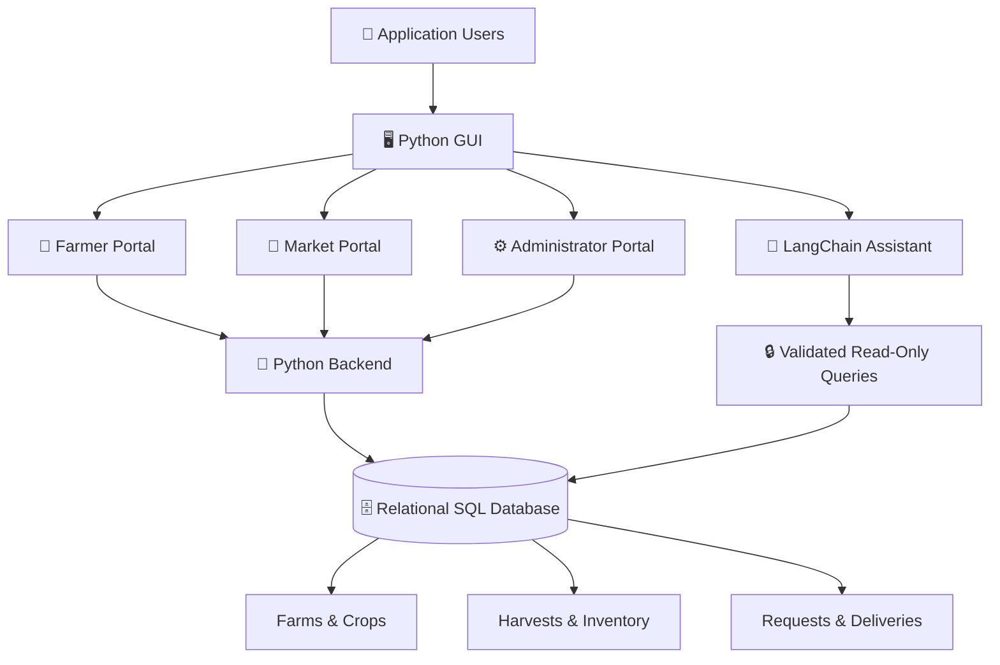

<div align="center">

# 🌱 HarvestLink

### Connecting Local Farms to Local Markets

**A Smart Farm-to-Market Food Availability & Inventory Management System**

<br>


<br>

---

*Empowering local agriculture through smarter inventory management, transparent supply chains, and AI-assisted data access.*

</div>

## 📖 Overview

**HarvestLink** is a database-driven application designed to connect local farmers with markets across the United Arab Emirates.

The platform provides a centralized system for managing agricultural production, tracking harvested inventory, discovering available produce, and coordinating market requests.

By integrating a **relational SQL database**, a **Python-based graphical interface**, and a **LangChain-powered AI assistant**, HarvestLink aims to make local food availability more accessible, organized, and transparent.

> [!NOTE]
> HarvestLink is an educational prototype developed for COSC444 at Khalifa University. It uses synthetic data and does not represent official UAE agricultural inventories or government systems.

---

## ✨ Key Features

<table>
<tr>
<td width="50%" valign="top">

### 🚜 Farm Management
- Register and manage farms
- Track crop cultivation cycles
- Record expected harvests
- Manage harvested produce
- Upload product images

</td>
<td width="50%" valign="top">

### 📦 Inventory Tracking
- Monitor available stock
- Track reserved quantities
- Record inventory movements
- Manage produce losses
- Prevent inventory overselling

</td>
</tr>
<tr>
<td width="50%" valign="top">

### 🛒 Market Operations
- Search locally available produce
- Filter by crop and location
- Submit supply requests
- Track request fulfillment
- Confirm deliveries

</td>
<td width="50%" valign="top">

### 🤖 AI Database Assistant
- Ask natural-language questions
- Retrieve database insights
- Explore agricultural availability
- View supporting SQL records
- Safely handle unsupported queries

</td>
</tr>
</table>

---

## 🏗️ System Architecture



The SQL database acts as the **single source of truth**, while the application layer enforces inventory constraints, user permissions, and safe database transactions.

---

## 👥 User Roles

| Role | Responsibilities |
|:---|:---|
| 🚜 **Farmer** | Manage assigned farms, harvest lots, stock movements, and supply allocations |
| 🛒 **Market Buyer** | Discover produce, create market requests, and confirm deliveries |
| ⚙️ **Administrator** | Manage users, crop references, locations, and system records |

Each role operates within defined access permissions to protect data integrity.

---

## 🗄️ Database Design

HarvestLink uses a relational database designed around agricultural production, inventory management, and market transactions.

### Core Entities

| Entity | Description |
|:---|:---|
| `Users` | Application users and their roles |
| `Farms` | Registered agricultural farms |
| `Crops` | Supported agricultural products |
| `CropCycles` | Planting and harvesting periods |
| `HarvestLots` | Individual harvested batches |
| `HarvestLotImages` | Images associated with harvest lots |
| `StockMovements` | Inventory changes and adjustments |
| `Markets` | Registered market locations |
| `MarketRequests` | Produce requests from buyers |
| `Allocations` | Harvest quantities reserved for requests |
| `DeliveryReceipts` | Confirmed deliveries and discrepancies |

### Inventory Rules

The system is designed to ensure:

- Harvest forecasts remain separate from actual stock.
- Reserved produce cannot be allocated twice.
- Allocations never exceed available inventory.
- Partial requests and deliveries are supported.
- Stock changes maintain an auditable history.
- Quantity units are explicitly recorded.
- Failed transactions do not partially update inventory.

---

## 🤖 AI-Powered Database Assistant

HarvestLink integrates **LangChain** to support natural-language interaction with agricultural data.

Instead of manually navigating database tables, users can ask questions such as:

> 💬 "Which farms currently have tomatoes available?"

> 💬 "How much cucumber stock is available in Abu Dhabi?"

> 💬 "Which market requests are partially fulfilled?"

> 💬 "What produce is expected to be harvested next week?"

### 🔐 AI Safety

The assistant uses validated, read-only database access.

- No unrestricted AI-generated database modifications
- No exposure of database credentials
- No unauthorized access to user records
- Ambiguous questions are handled explicitly
- Database records remain the authoritative source

---

## 🛠️ Technology Stack

| Component | Technology |
|:---|:---|
| Programming Language | Python |
| Database | Relational SQL |
| User Interface | Python GUI |
| AI Integration | LangChain |
| Data Access | Parameterized SQL Queries |
| Image Support | JPG / PNG |
| Version Control | Git & GitHub |

> Specific database engines, GUI frameworks, and AI model providers will be documented as implementation decisions are finalized.

---

## 📁 Project Structure

**Proposed repository organization:**

```text
harvestlink/
│
├── app/
│   ├── gui/
│   ├── database/
│   ├── services/
│   └── ai/
│
├── sql/
│   ├── schema.sql
│   └── seed.sql
│
├── assets/
│   └── images/
│
├── docs/
│   ├── diagrams/
│   └── reports/
│
├── tests/
│
├── main.py
├── requirements.txt
├── .gitignore
└── README.md
```

The structure may evolve as the project is implemented.

---

## 🚀 Getting Started

### Prerequisites

Before running HarvestLink, ensure you have:

- Python 3 installed
- A compatible SQL database
- Git
- Required Python dependencies
- Any necessary AI provider configuration

### 1. Clone the Repository

```bash
git clone https://github.com/YOUR_USERNAME/harvestlink.git
cd harvestlink
```

### 2. Create a Virtual Environment

```bash
python -m venv .venv
```

Activate it:

**Windows**
```bash
.venv\Scripts\activate
```

**macOS / Linux**
```bash
source .venv/bin/activate
```

### 3. Install Dependencies

```bash
pip install -r requirements.txt
```

### 4. Configure the Database

Create and populate the database using the project's SQL scripts.

Configure database connection settings according to the selected SQL engine.

### 5. Run the Application

Once the entry point is implemented:

```bash
python main.py
```

> [!IMPORTANT]
> Setup instructions are preliminary. Database configuration, environment variables, and application commands will be updated when the implementation is complete.

---

## 🗺️ Development Roadmap

- [ ] **Phase 0:** Project planning and team setup
- [ ] **Phase 1:** ER diagram, relational schema, and SQL population
- [ ] **Phase 2:** Python GUI and core database operations
- [ ] **Phase 2:** Image upload and display
- [ ] **Phase 2:** LangChain assistant integration
- [ ] **Phase 3:** Implement a selected advanced feature
- [ ] **Phase 4:** Error handling and data validation
- [ ] **Phase 5:** Testing, documentation, and final demonstration

---

## 🧪 Testing Strategy

The project will be tested across several categories:

| Test Category | Focus |
|:---|:---|
| Database Integrity | Keys, constraints, and relationships |
| Inventory Logic | Harvests, reservations, losses, and deliveries |
| Access Control | Role-specific permissions |
| GUI Operations | Form validation and user workflows |
| AI Assistant | Valid, ambiguous, and unsupported questions |
| Image Handling | Upload, persistence, and retrieval |
| Transaction Safety | Rollback and overselling prevention |

---

## 🌍 Motivation

The UAE continues to prioritize food security, sustainable agriculture, and resilient local food supply chains.

HarvestLink explores how database technologies can help improve visibility into locally produced food and simplify coordination between agricultural producers and markets.

The project is inspired by the broader goals of the **UAE National Food Security Strategy 2051**.

---

## 🎓 Academic Information

| | |
|:---|:---|
| **University** | Khalifa University of Science and Technology |
| **Department** | Computer Science |
| **Course** | COSC444 — Database Systems |
| **Academic Year** | Fall 2026–2027 |
| **Project Type** | Relational Database Application |
| **Project Name** | HarvestLink |

---

## 👨‍💻 Development Team

Developed as part of the COSC444 Database Systems course.

| Team Member | Role |
|:---|:---|
| Tehsin Shaik | To be assigned |
| Raghad Elajab | To be assigned |
| Ayesha Almheiri | To be assigned |

All team members contribute to database design and implementation.

---

## 📄 License

This project is developed for educational and academic purposes.

A license will be selected if the project is released for public reuse.

---

<div align="center">

### 🌱 HarvestLink

**From Local Farms to Local Markets.**

*Built with Python, SQL, and AI.*

<br>

Made for **COSC444 — Database Systems**
**Khalifa University | 2026–2027**

</div>
